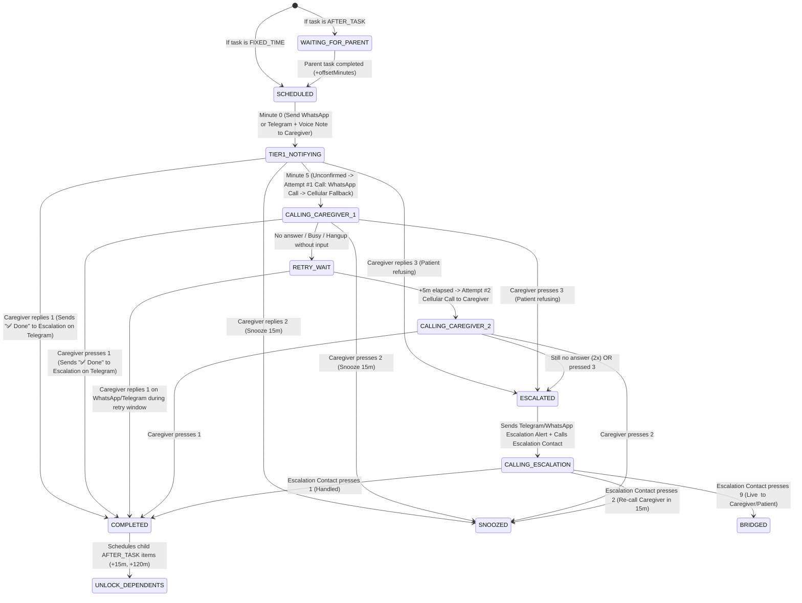
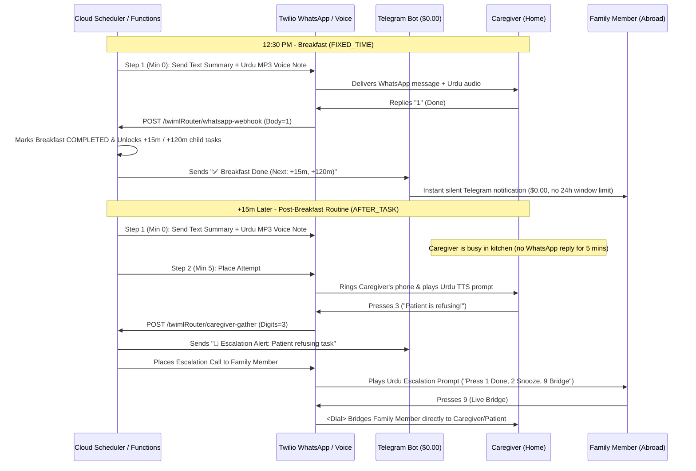

# Irhamhuma (رَّبِّ ارْحَمْهُمَا) — System Architecture & Technical Reference

> *"Rabbi irhamhuma kama rabbayani saghira"* — "My Lord, have mercy upon them as they brought me up when I was small." (Surah Al-Isra 17:24)

## 1. Problem Statement & Motivation
When an elderly parent (**Patient**, e.g., *Abbu*) is discharged from the hospital, strict adherence to a daily nutrition, hydration, and routine schedule is critical for recovery. However:
1. **Patient Reluctance**: The patient may refuse or delay meals or scheduled routines.
2. **Caregiver Overload**: A primary caregiver at home (**Caregiver**, e.g., *Ammi*) has to prepare meals, manage the household, and care for the patient. A passive phone alarm is easily dismissed while busy in the kitchen or when the patient says *"Give me 10 minutes"*—and then forgotten.
3. **Meal-Dependent Timing (`AFTER_TASK`)**: Many items are chained to meals (e.g., *Post-Breakfast Routine 15 minutes after Breakfast*, *Mid-Morning Snack 2 hours after Breakfast*, *Post-Dinner Routine 15 minutes after Dinner*). Fixed-time alarms fail whenever breakfast shifts by 30–45 minutes.
4. **Cross-Border Visibility Without Nagging**: A family member living abroad (**Escalation Contact**) wants peace of mind knowing tasks were completed without constantly calling to ask, and wants an immediate escalation call with live call-bridging (`Press 9`) only when the caregiver actually needs help.

**Irhamhuma** solves this with a **Caregiver-First Messaging & Voice Escalation Loop** powered by **Angular**, **Firebase (Firestore, Cloud Scheduler, Cloud Functions Gen 2)**, **Google Cloud Text-to-Speech WaveNet (`ur-PK`, `hi-IN`, `ar-XA`, `bn-IN`, `en-US`)**, **Gemini 2.5 Flash (with Zod Structured Outputs)**, **Telegram Bot API ($0.00 Free Messaging)**, and **Twilio Programmable Voice & WhatsApp**.

---

## 2. System Architecture Diagram

```mermaid
flowchart TD
    subgraph Frontend ["Angular Web App (Firebase Hosting)"]
        UI["Daily Schedule & Timeline UI"]
        AIInput["AI Schedule Builder (Plain text or image)"]
        Settings["Per-Role Channels, Personas & Voices"]
        Kiosk["Caregiver Kiosk Mode (/kiosk)"]
        Simulator["Interactive Voice & IVR Simulator"]
    end

    subgraph Backend ["Firebase & Google Cloud"]
        FS[("Cloud Firestore\n(careConfig, scheduleTemplates, dailyTasks)")]
        CS["Cloud Scheduler\n(Every 1 min tick)"]
        CF["Cloud Functions Gen 2\n(tickCareScheduler & twimlRouter)"]
        Gemini["Gemini 2.5 Flash + Zod\n(Structured Schedule Parser)"]
        TTS["Google Cloud TTS (WaveNet / Standard)\nOn-the-Fly MP3 Audio Stream (/twiml/audio.mp3)"]
    end

    subgraph Channels ["Messaging & Telephony Channels"]
        WA["Twilio WhatsApp\n(Text Summary + Native Urdu MP3 Voice Note)"]
        TG["Telegram Bot ($0.00 Free)\n(Instant Completion Updates, Escalation Alerts & 1-Tap Buttons)"]
        TwilioVoice["Twilio Programmable Voice\n(WhatsApp Call + PSTN Cellular Fallback + <Dial> Bridge)"]
    end

    UI -->|"/twiml/sync-state (x-irhamhuma-key)"| CF
    Settings -->|"/twiml/sync-state (Auto-registers Telegram Webhook)"| CF
    Kiosk --> CF
    AIInput --> Gemini
    CS --> CF
    CF <--> FS
    CF --> TTS
    CF -->|"Step 1 (Min 0): Caregiver Channel"| WA
    CF -->|"Step 1 (Min 0) or Completion/Escalation"| TG
    CF -->|"Step 2 (Min 5 & 10): Call Caregiver\nStep 3: Escalate to Family Member"| TwilioVoice
    WA -->|"Reply 1 (Done) / 2 (Snooze) / 3 (Escalate)"| CF
    TG -->|"1-Tap Inline Buttons (DONE / SNOOZE / TWILIO_NOW)"| CF
    TwilioVoice -->|"DTMF Keypad 1 / 2 / 3 / 9"| CF
```

---

## 3. Caregiver-First Escalation & Call Flow State Machine

---

## 4. Sequence Diagram: Caregiver-First Verification, Completion Ping & Refusal Escalation

---

## 5. Key Technical Decisions

### A. Per-Role Channel Hybrid (WhatsApp for Restricted Regions + Telegram for $0.00 Updates)
- **Why Meta's 24-Hour Window Blocks Passive Escalation Numbers on WhatsApp**: Meta's Cloud API rejects freeform WhatsApp messages (`Error 63016`) if the recipient hasn't sent an inbound message within 24 hours. While a caregiver replying `1` daily keeps their 24-hour window open, an escalation contact who only receives passive `✅ Done` notifications gets blocked after 24 hours unless paying for Meta Utility Templates.
- **Why Telegram Solves This at $0.00**: Telegram Bot API has **no 24-hour messaging window** and costs **$0.00 forever**.
  - **Hybrid Mode (e.g. Pakistan + Europe/US)**: In countries where Telegram is throttled/blocked (like Pakistan), set `caregiverChannel: 'WHATSAPP'` for the parent/caregiver at home and `escalationChannel: 'TELEGRAM'` for the family member abroad.
  - **Pure Telegram Mode (India, Bangladesh, Middle East, Europe, Americas)**: Set both `caregiverChannel: 'TELEGRAM'` and `escalationChannel: 'TELEGRAM'` to run 100% free messaging with native voice notes and 1-tap inline buttons (`✅ Done`, `⏳ Snooze`, `🚨 Escalate`).
- **Auto-Webhook Registration**: Saving `telegramBotToken` in Settings automatically invokes `https://api.telegram.org/bot<TOKEN>/setWebhook` pointing to `/twimlRouter/telegram-webhook`. Sending `/start` to the bot replies with the user's numeric `Chat ID`.

### B. 100% Native Multi-Language `<Play>` Streaming (`ur-PK`, `hi-IN`, `ar-XA`, `bn-IN`, `en-US`)
Twilio's built-in `<Say>` verb does not support Pakistani Urdu (`ur-PK`). Instead, `twimlRouter` exposes `GET /twimlRouter/audio.mp3?taskId=...&type=caregiver`, which synthesizes the Nastaliq Urdu script (`urduScriptNative`) at `0.90x` speaking rate via Google Cloud Text-to-Speech (`ur-PK-Standard-A` / `ur-IN-Wavenet-A`) and streams `audio/mpeg` directly into Twilio `<Play>`, WhatsApp Voice Notes, Telegram Audio, and the Caregiver Kiosk.

### C. WhatsApp Voice Call + Automatic PSTN Cellular Fallback
When calling the caregiver at Minute 5 (`placeOutboundCall`), Irhamhuma first attempts a **Twilio WhatsApp Voice Call** (`to: whatsapp:+...`) and automatically falls back to a standard **PSTN cellular call** (`to: +...`) if WhatsApp calling is not enabled or fails at the network/permission level (`handleCallStatusWebhook` catches `channel === 'whatsapp'` failures and immediately dials cellular on the same attempt).

### D. Built-In Security Architecture (Zero-Trust Public Webhooks)
1. **Cloud-First Pull on Startup (`pullOnly: true`)**: Opening the dashboard on a new phone or browser strictly pulls `config`, `templates`, and `dailyTasks` from Firestore and never overwrites cloud state with local defaults.
2. **Dashboard Passcode Auth (`x-irhamhuma-key`)**: `/sync-state` and `/trigger-*` endpoints verify `x-irhamhuma-key` against `process.env.DASHBOARD_API_KEY` using `crypto.timingSafeEqual`.
3. **Twilio Signature Validation (`twilio.validateRequest`)**: All Twilio webhook endpoints verify `X-Twilio-Signature` against `process.env.TWILIO_AUTH_TOKEN` and reject unsigned requests with `403 Forbidden`.
4. **Country-Code Prefix Allowlist (`ALLOWED_CALL_PREFIXES`)**: Outbound calls only dial numbers matching configured country prefixes (e.g., `+92,+46`) and read phone numbers exclusively from Firestore `settings/careConfig`.
